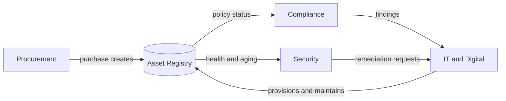

# 01 - Stakeholders and Personas

## Security Team

**Goal:** know the health and aging of everything deployed on the domain.

Key questions:
- Which assets run which OS and version? How many are obsolete or out of support?
- Which assets are approaching end-of-support in the next 90 days?
- Which production or critical assets are unsupported?
- Which assets have no owner, or have not been seen recently?

Primary views: Security dashboard, obsolete asset list, OS/version breakdown, drill-downs with export.
Access: read everything; write limited to security tags and review notes.

## IT and Digital

**Goal:** maintain the inventory of what is provisioned and developed.

Records:
- Provisioned systems on servers
- VM inventory (host, OS, resources)
- Developed applications (owner, stack, repo, environment, dependencies)
- Infrastructure inventory
- Network device inventory and locations (site, building, rack)

Key workflows: create/update assets, link applications to the VMs/servers they run on, bulk import from spreadsheets, retire assets.
Access: full read/write on inventory.

## Enterprise Business Services (Procurement Unit)

**Goal:** track purchased goods and procurement activity.

Records: vendors, purchase requests, purchase orders, invoices, warranty and contract dates, and the link from a purchase to the resulting asset.

Key workflows: raise and approve a request, receive goods and register assets, track warranty expiry.
Access: procurement data read/write; asset data read.

## Compliance

**Goal:** show registered goods and assets comply with internal policy.

Records: policies, controls mapped to asset types, checks/attestations, exceptions with expiry.

Key workflows: assess an asset against controls, record an exception, report compliance status by team or asset type.
Access: compliance data read/write; asset data read.

## Platform roles

- **Admin:** manages users, roles, teams, reference data (OS catalog, locations).
- **Viewer:** read-only access to non-sensitive asset data (for example management).

## Cross-team collaboration

