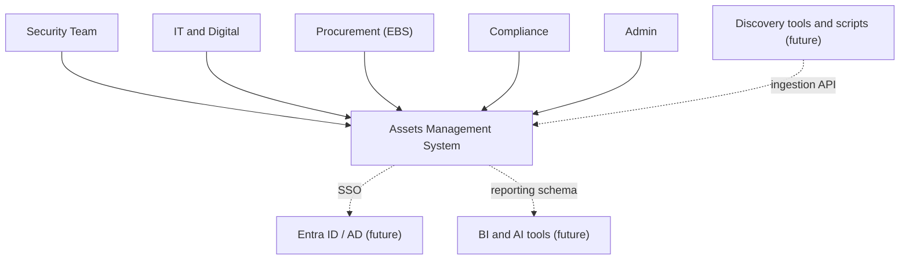
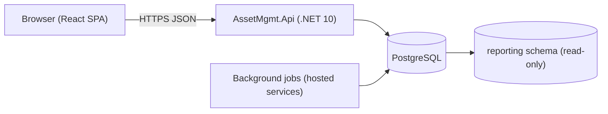
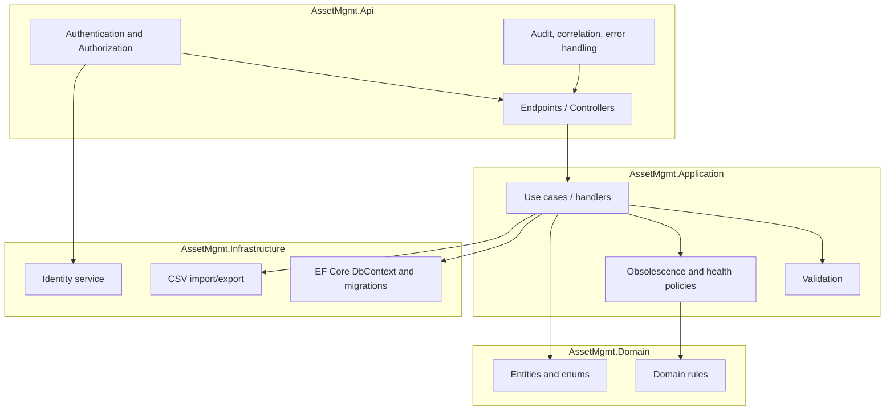
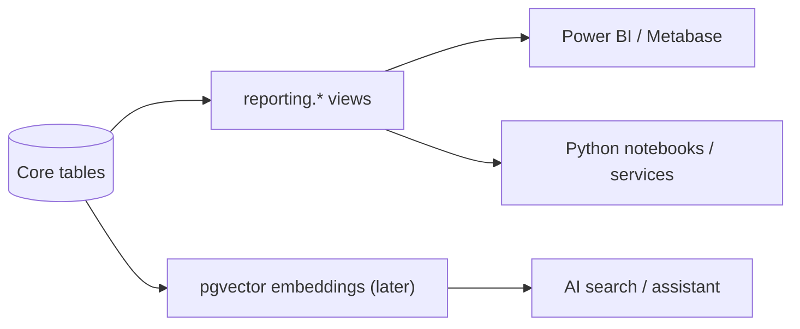

# 03 - Architecture

## Technology choices

| Concern | Choice | Notes |
|---|---|---|
| Backend | ASP.NET Core on .NET 10 (LTS) | Minimal APIs / controllers, OpenAPI |
| ORM | EF Core + Npgsql | Migrations in code |
| Database | PostgreSQL | JSONB for custom attributes, `pgvector` later |
| Frontend | React + TypeScript (Vite) | TanStack Query, typed client from OpenAPI |
| Auth | ASP.NET Core Identity (local) | Behind an abstraction; Entra ID/AD (OIDC) later |
| Packaging | Docker / Docker Compose | Postgres + API + web |
| Tests | xUnit, Testcontainers, Playwright | See testing section |

## C4 Level 1 - System context



## C4 Level 2 - Containers



- The SPA is served as static files (by the API host or a reverse proxy) and talks only to the API.
- Background jobs run inside the API process initially (hosted services): stale-asset flagging, EOL notifications, materialising dashboard aggregates if needed.
- The `reporting` schema holds views over the core tables for BI/AI, accessed through a read-only database role.

## C4 Level 3 - API components



## Layering and dependency rule

- `Domain` depends on nothing.
- `Application` depends on `Domain` and defines interfaces (repositories, clock, current user).
- `Infrastructure` implements those interfaces (EF Core, Identity, CSV).
- `Api` composes everything and holds the HTTP surface.
- Dependencies point inward only. Business rules (obsolescence, status transitions) live in `Domain`/`Application`, never in controllers or SQL views.

## Solution layout

```
src/
  AssetMgmt.Domain/
  AssetMgmt.Application/
  AssetMgmt.Infrastructure/
  AssetMgmt.Api/
tests/
  AssetMgmt.Tests/            unit + integration (Testcontainers)
web/                          React SPA
docker-compose.yml
```

## Authentication and authorization

- Phase 1: local accounts via ASP.NET Core Identity, issuing a secure HTTP-only cookie (or short-lived JWT + refresh) to the SPA.
- Authorization is policy-based. Controllers declare required permissions (for example `assets.write`), and roles map to permissions (see [RBAC](07-rbac-and-security.md)).
- An `IIdentityProvider` abstraction keeps the app independent of the sign-in mechanism. Adding Entra ID means registering an OIDC scheme and mapping directory groups to roles; no endpoint changes.

## Data architecture

- One **Asset** backbone table plus 1:0..1 detail tables per type ([domain model](04-domain-model.md)).
- Reference data (OS catalog, locations, teams) is normalised.
- JSONB `custom_attributes` for team-specific fields that do not justify columns.
- Audit log is append-only, written in the same transaction as the change.
- Soft delete via `is_deleted` and `retired_at`; never hard-delete assets.

## Ingestion

`POST /api/ingest/assets` accepts batches keyed on a stable external identifier (for example hostname + source system). Upsert semantics, per-item result report, and a `last_seen_at` update that powers the stale-asset view. Authenticated with an API key bound to a service account with an `ingest` role.

## Analytics and AI path



No re-platforming is needed: a read-only role and `reporting` views are added when required. A separate Python analytics/AI service can read the same database or a replica.

## Deployment view

- Local: `docker compose up` (Postgres, API, web).
- Environments: dev, UAT, prod, each with its own database and secrets.
- Configuration through environment variables; secrets from the platform's secret store, never from git.
- Reverse proxy terminates TLS; API and static SPA are behind it.

## Observability

- Serilog structured logs with correlation IDs, health endpoints (`/health/live`, `/health/ready`), and OpenTelemetry-ready instrumentation.

## Testing strategy

- Unit: domain rules (obsolescence, status transitions, health score).
- Integration: API plus real PostgreSQL via Testcontainers, including migration application and authorization checks.
- End-to-end: Playwright smoke (login, create asset, dashboard).
- Contract: OpenAPI is generated in CI; the TypeScript client is regenerated and diffed.

## Risks and mitigations

| Risk | Mitigation |
|---|---|
| Data quality at import | Dry-run import, validation report, required-field rules, owner mandatory for Active assets |
| Scope creep into a full CMDB | Non-goals in [vision](00-vision-and-scope.md); phase gates |
| Adoption | Fast bulk import, exports teams already use, role-tailored dashboards |
| Auth migration later | Identity abstraction from day one, ADR-0004 |
