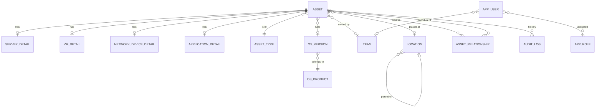
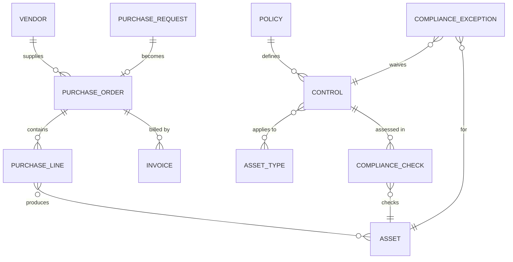
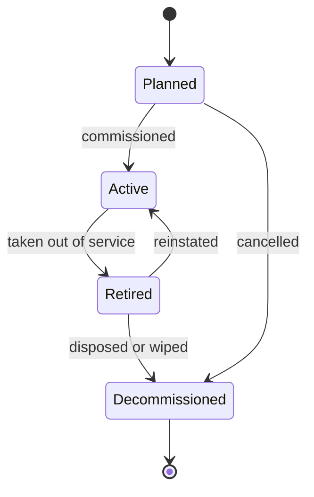

# 04 - Domain Model

## Core ERD

## Phase 4 and 5 extension

## Entities

### Asset (backbone)
The single record every team sees. Fields include tag, name, type, status, environment, criticality, owner team, location, OS version, lifecycle dates (`acquired_at`, `end_of_support_at`, `retired_at`), `last_seen_at`, `custom_attributes` (JSONB). Full list in the [data dictionary](05-data-dictionary.md).

### Detail entities (1:0..1 with Asset)
- **ServerDetail:** hostname, IP addresses, role, CPU/RAM/storage, manufacturer, serial.
- **VmDetail:** hypervisor, host asset, vCPU, RAM, disk, cluster.
- **NetworkDeviceDetail:** vendor, model, firmware, serial, management IP, device role (switch, router, firewall, AP), port count.
- **ApplicationDetail:** stack/runtime, repo URL, application URL, business owner, technical owner, data classification.

### OS catalog
- **OsProduct:** vendor and family (for example Microsoft Windows Server, Ubuntu, RHEL, Cisco IOS).
- **OsVersion:** version label, release date, `mainstream_end_at`, `extended_end_at` (end-of-support). Maintained by Admin/Security. This table makes obsolescence computable.

### Relationships
`AssetRelationship(source, target, type)` where type is `RunsOn`, `HostedBy`, `DependsOn`, `ConnectedTo`. Examples: Application RunsOn VM; VM HostedBy Server; Server ConnectedTo Switch.

### Location
Self-referencing hierarchy with a `kind` of Site, Building, Room or Rack.

### Identity
`AppUser`, `AppRole`, `Team`, plus the assignment tables. See [RBAC](07-rbac-and-security.md).

### AuditLog
Append-only: entity type, entity id, action, user, timestamp, correlation id, and JSON of changed fields (old/new).

## Asset status lifecycle

Rules:
- An `Active` asset must have an owner team and a type.
- A `Decommissioned` asset is read-only except for notes.
- Transitions are audit-logged with a reason.

## Obsolescence rules

Evaluated by the domain `LifecyclePolicy`, using the asset's OS version (and `end_of_support_at` override if set):

| Condition | Health state |
|---|---|
| End of support date is in the past | **Obsolete** |
| End of support within the warning window (default 90 days) | **Nearing EOL** |
| End of support later than the window | **Supported** |
| No OS version recorded | **Unknown** |

Additional flags: **Stale** (no update or `last_seen_at` for more than N days, default 30) and **Ownerless** (no owner team).

## Health score (S priority)

A 0-100 score per asset: start at 100, subtract weighted penalties for Obsolete, Nearing EOL, Stale, Ownerless, and criticality multipliers. Team and domain scores are the average weighted by criticality. Weights live in configuration, not code.
