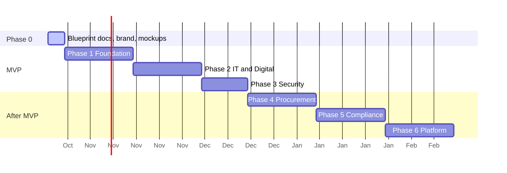

# 08 - Roadmap

Sequencing principle: build the shared core first because Security, Procurement and Compliance all consume it.

Dates are indicative planning aids, not commitments; revisit after Phase 1.

## Phase 0 - Blueprint, brand, mockups
Docs, git (`main` + `dev`), brand tokens, static mockups. **Exit:** stakeholders have reviewed docs and mockups.

## Phase 1 - Foundation
Solution scaffold, Docker Compose, domain model, migrations, seed data, local auth and RBAC, audit logging, generic asset CRUD, search/filter, relationships, CSV import/export.
**Exit:** an Admin can sign in, manage users, and create/search/import assets; integration tests green.

## Phase 2 - IT and Digital (MVP)
Servers, VMs, network devices, applications, locations; relationship views; dry-run bulk import; ingestion endpoint.
**Exit:** IT and Digital have loaded real inventory and can answer "what runs on this host".

## Phase 3 - Security (MVP)
OS catalog with EOL dates, dashboard, obsolete/nearing-EOL/stale/ownerless views, drill-down and export, saved filters, health score.
**Exit:** Security produces the OS/version and obsolescence report with no spreadsheet work.

## Phase 4 - Procurement
Vendors, requests, orders, invoices, warranty/contract tracking, purchase-to-asset linking, optional approval flow.

## Phase 5 - Compliance
Policy and control library, control mapping to asset types, checks and attestations, exceptions with expiry, status reporting.

## Phase 6 - Platform
Entra ID / AD SSO, notifications (email/Teams), `reporting` schema and BI, `pgvector` AI search, MFA.

## Key risks

| Risk | Impact | Mitigation |
|---|---|---|
| Poor source data quality | Low trust in dashboards | Dry-run import, validation report, data owner per team |
| Unclear field needs per team | Rework | Docs review in Phase 0; JSONB custom attributes absorb variance |
| Scope creep toward full CMDB | Delay | Phase gates and non-goals |
| EOL catalog goes stale | Wrong obsolescence results | Named catalog owner (Security), last-reviewed date shown in UI |
| Undecided hosting | Late deployment surprises | Container-first, 12-factor config |

## Open questions

1. Asset tag format and who allocates tags?
2. Which fields are mandatory for each asset type?
3. Where does inventory data come from first (spreadsheets, vCenter, SCCM/Intune, network scans)?
4. Hosting target and database backup tooling?
5. Required retention period for audit data?
6. When is Entra ID / AD SSO needed?
