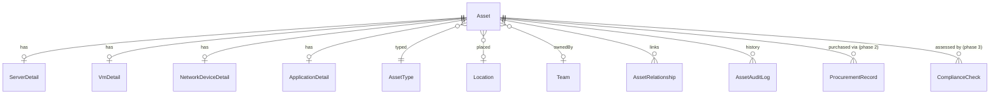

# Internal Asset Management System - Plan

## Decisions
- Backend: ASP.NET Core on .NET 10 (LTS), EF Core + Npgsql, PostgreSQL.
- Frontend: React + TypeScript (Vite), TanStack Query, a component library such as shadcn/ui or MUI.
- Auth: local accounts (ASP.NET Core Identity + JWT or cookie), role-based, built behind an abstraction so Entra ID/AD (OIDC) can replace it later.
- MVP scope: core asset registry + IT and Digital inventory + Security dashboard. Procurement and Compliance come after.
- Future analytics/AI: Postgres stays the system of record. A read-only `reporting` schema and `pgvector` can be added later without re-architecture.

## Repo layout (monorepo in `/Users/kwekku/Desktop/Builds/AssetsMain`)
- `src/AssetMgmt.Api` - controllers/minimal APIs, auth, OpenAPI
- `src/AssetMgmt.Application` - use cases, validation, DTOs
- `src/AssetMgmt.Domain` - entities and enums
- `src/AssetMgmt.Infrastructure` - EF Core DbContext, migrations, seed
- `tests/AssetMgmt.Tests` - unit + integration (Testcontainers Postgres)
- `web/` - React app
- `docker-compose.yml` - Postgres + API + web for local dev

## Domain model (core design)
One shared **Asset** table is the backbone, so every team views the same records. Type-specific detail hangs off it.

- **Asset**: id, tag, name, type, status (Planned/Active/Retired/Decommissioned), owner team, location, criticality, environment (Prod/UAT/Dev), lifecycle dates (acquired, end-of-support, retired), custom attributes (JSONB).
- **Details**: OS name/version, hostname/IP, hypervisor/host (VMs), vendor/model/firmware/serial (network), repo/stack/owner/URL (apps).
- **OsCatalog / SoftwareVersion**: OS + version with end-of-life/end-of-support dates. This is what makes obsolescence computable. A version is "obsolete" when EOL < today, and "approaching" when EOL is within N days.
- **AssetRelationship**: depends-on / runs-on / hosted-by (an app runs on a VM, a VM runs on a host).
- **Location**: hierarchy (site > building > room/rack).
- **User, Role, Team**, **AssetAuditLog** (who changed what, when).

## Roles (RBAC)
- Admin, ITDigital (read/write inventory), Security (read-all + security views), Procurement (phase 2), Compliance (phase 2), Viewer. Team ownership and role checks are enforced in the API layer.

## Ground rule: everything lives in the workspace
Every file, doc, asset and mockup is created under `/Users/kwekku/Desktop/Builds/AssetsMain`, nothing outside it. Concretely:
- The logo and any other brand assets are downloaded straight into `docs/design/brand/` (the temporary research copies in `/tmp` are not used or referenced).
- A copy of this plan is saved as `docs/09-build-plan.md` so the plan travels with the repo and is committed to git.
- Mockups reference the logo and tokens by relative paths inside the workspace, so they open offline with no external links.
- Tooling and caches stay in the workspace (`.gitignore` covers `node_modules`, `bin/obj`, `.env`).

## Phase 0 - Blueprint, git, brand, mockups (do this first, no app code yet)

### 0.1 Architecture and blueprint docs (`/docs`)
- `README.md` - index and how to read the docs
- `00-vision-and-scope.md` - problem, goals, non-goals, MVP vs later
- `01-stakeholders-and-personas.md` - Security, IT and Digital, Enterprise Business Services (Procurement), Compliance; their key questions and workflows
- `02-requirements.md` - functional requirements per team (user stories) + non-functional (security, audit, performance, availability)
- `03-architecture.md` - C4 context/container/component diagrams (mermaid), layering, auth abstraction, ingestion, reporting extension point
- `04-domain-model.md` - ERD (mermaid), entity definitions, lifecycle/status state machine, obsolescence rules
- `05-data-dictionary.md` - table/field list, enums, indexes, JSONB custom attributes
- `06-api-outline.md` - resource endpoints, filtering/pagination conventions, ingestion API, error format
- `07-rbac-and-security.md` - role x permission matrix, audit logging, data classification, secrets, threat notes
- `08-roadmap.md` - phases, milestones, risks
- `09-build-plan.md` - copy of this plan
- `adr/` - ADR-0001 .NET 10, ADR-0002 PostgreSQL, ADR-0003 React SPA, ADR-0004 local auth with pluggable SSO, ADR-0005 single Asset backbone + detail tables

### 0.2 Git
- `git init -b main`, add `.gitignore` (dotnet, node, env), `.editorconfig`, root `README.md`.
- Commit the docs on `main`, then create `dev` from `main`. Exactly two branches, `main` and `dev`; leave `dev` checked out for ongoing work.
- No remote or push unless asked. Branch protection and a PR flow (dev -> main) are documented in the README.

### 0.3 Brand guide from https://onboarding.ghana.accessbankplc.com/ (reference only, not layout)
Extracted from the live site's CSS and markup:
- Primary blue `#376cc6` (hover/dark `#2d5ba8`)
- Accent orange `#f57f20` (hover/dark `#d46a1a`)
- Accent green `#8aac11` (dark `#7a9a0f`)
- Neutrals `#0f172a`, `#e2e8f0`, `#f1f5f9`, `#f8fafc`, white
- Semantic: danger `#ef4444`, plus soft tints (`#eff6ff`, `#fffbeb`, `#f0fdf4`, `#fef2f2`)
- Font: Effra (site's brand font), with fallback `system-ui, -apple-system, Segoe UI, sans-serif`. Effra is a licensed font, so mockups use the fallback unless you supply the font files.
- Logo: `/brand/access-logo.png` (800x196 PNG, orange diamond mark + dark-blue "access" wordmark). Its blue (logo) is deeper than the UI blue `#376cc6`; the mockups will sample the wordmark blue for the header or sidebar and use `#376cc6` for interactive UI.
- Pantone: the site publishes hex values only, not Pantone codes. The brand guide will list the nearest Pantone Matching System references labelled "approximate, verify against official Access Bank brand guidelines before print". The tokens that drive the screens remain the hex values.
- Logo is a bank trademark: the file is kept in `docs/design/brand/` and used only in internal mockups.

Deliverable: `docs/design/brand/brand-guide.md` and `design-tokens.css` (CSS variables) reused later by the React app theme (`web/`).

### 0.4 Mockup screens (`/mockups`, static HTML/CSS, openable in a browser; no build step)
- `login`, `dashboard-security` (OS/version mix, obsolete/nearing-EOL, stale and ownerless assets), `assets-list` (filters, search, status chips), `asset-detail` (relationships, history), `it-inventory` (servers/VMs/network/apps tabs), plus Procurement and Compliance placeholder screens.
- Layout is our own (left nav + top bar + data-dense tables/cards), using only the brand colors, type and logo from the reference site, not its page structure.
- If you prefer Figma over HTML mockups, the Figma tools are available; default is HTML so everything lives in this workspace.

## Phase 1 - Foundation
- Scaffold solution, Docker Compose, EF Core migrations, seed data (OS catalog with EOL dates, locations, teams, sample assets).
- Auth: register/login, roles, user admin screen, audit logging middleware.
- Generic asset CRUD, search/filter/pagination, relationships, CSV import/export.

## Phase 2 - IT and Digital module (MVP)
- Screens: Servers, VMs, Network devices, Applications, Locations.
- Type-specific forms and validation, relationship view ("what runs on this host").
- Bulk CSV import with a dry-run preview and error report.
- Later hook: an ingestion endpoint (`POST /api/ingest`) so discovery agents or scripts (AD, vCenter, SCCM/Intune, network scans) can push inventory.

## Phase 3 - Security module (MVP)
- Dashboard: assets by OS and version, obsolete / nearing-EOL counts, unsupported OS by environment and criticality, stale assets (not seen in N days), assets with no owner.
- Drill-down lists with export, saved filters.
- Computed "health/aging score" per asset and per team.

## Later phases (same core, not in MVP)
- **Procurement (Enterprise Business Services)**: vendors, purchase requests/orders, invoices, warranty and contract dates, link purchases to assets, an approval workflow.
- **Compliance**: policy library, controls mapped to asset types, checks/attestations, exceptions with expiry, compliance status per asset.
- **Platform**: Entra ID / AD SSO and group-to-role mapping, notifications (email/Teams) for EOL/warranty/compliance expiry, `reporting` schema + BI (Power BI/Metabase), AI search with `pgvector`.

## Testing and quality
- Unit tests for domain rules (obsolescence logic, status transitions).
- Integration tests against a real Postgres container.
- A minimal React component/e2e smoke test (Playwright) for login, create asset and the dashboard.
- OpenAPI spec generated and used to type the frontend client.

## Open items to settle during the build (not blockers)
- Exact asset fields each team needs (tag format, required fields), and the expected scale (a few hundred vs tens of thousands of assets).
- Where inventory will first come from (spreadsheets vs a discovery tool).
- Hosting target (on-prem vs Azure), which affects deployment config only.
